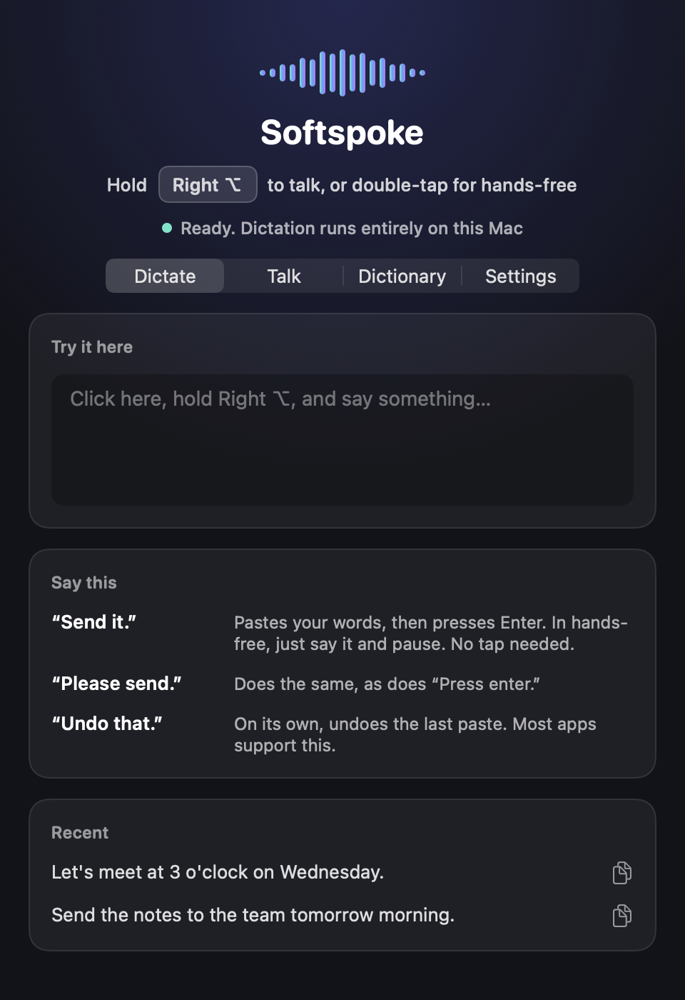
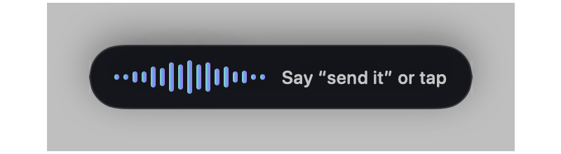

# Softspoke

Private voice dictation for the Mac. Hold a key, speak, and your words appear at the cursor in any app. Speech recognition runs entirely on your Mac, with no account or subscription.

<p>
  
</p>
<p>
  
  
</p>

## Features

- **Dictate anywhere:** hold the key to talk, and the text is pasted where your cursor is. Your clipboard is restored afterward.
- **Hands-free mode:** double-tap the key to keep recording without holding it.
- **Voice commands:** say "send it" to press Enter, or "undo that" to take back the last paste.
- **Text cleanup:** removes filler words and repeated words, and handles self-corrections like "meet at 3, no wait, 4".
- **Personal dictionary:** teach it names and jargon, and fix words it keeps mishearing.
- **Live feedback:** a floating pill with a waveform that follows your voice, and plain messages when something's wrong.
- **Your choice of key:** Right Option, Command, Control, Shift, or fn.
- **Optional spoken chat with Claude:** the Talk tab holds a voice conversation using built-in Mac voices. It's off by default and needs your own API key.

## Privacy

Dictation never leaves your Mac. Audio is kept in memory only while it's being transcribed, and the speech engine listens only on `127.0.0.1`. The troubleshooting log at `~/Library/Logs/Softspoke.log` records events and counts, never your words.

The optional Talk tab is the one exception: it sends the text of your conversation to Anthropic, under your own API key, which is stored in your Keychain.

## Requirements

- macOS 13 or later (developed on Apple silicon)
- Xcode Command Line Tools
- [Homebrew](https://brew.sh), for [whisper.cpp](https://github.com/ggml-org/whisper.cpp)
- About 500 MB of free disk space for the engine and speech model

## Install

There's no prebuilt download yet, so you build it yourself:

```bash
git clone https://github.com/Youssdk10/Softspoke.git
cd Softspoke
./setup.sh
./make-signing-cert.sh
./build.sh --install
open ~/Applications/Softspoke.app
```

`make-signing-cert.sh` is optional but recommended. It creates a self-signed certificate in your login Keychain, so that macOS keeps Softspoke's permissions when you rebuild. Without it, each rebuild loses them.

On first launch, allow **Microphone** and **Accessibility** from the app's window. Accessibility is what lets Softspoke notice the key and paste into other apps.

## How to use it

| To do this | Do this |
|---|---|
| Dictate | Hold **Right ⌥**, speak, and let go |
| Dictate hands-free | Double-tap **Right ⌥**, then tap once to finish |
| Cancel hands-free | Press **Esc** |
| Send a message | End with "send it", "send that", "please send", "press enter" or "press return" |
| Undo the last paste | Say "undo that" on its own |
| Start a new line | Say "new line" or "new paragraph" as its own phrase |

When holding the key, pause before the command so that it ends as its own sentence. In hands-free mode, say the command and stop talking. It sends about a second later, with no tap needed.

## How it works

```
Key press → Recorder (16 kHz mono) → whisper-server (local) → TextCleaner → paste
                  │
                  └─ hands-free only: recent audio is checked for a spoken command
```

- **`SoftspokeCore`** holds the logic: text cleanup, voice commands, key gestures, audio encoding and the Whisper client. It has no UI, so it can be tested without a microphone or any permissions.
- **`Softspoke`** is the menu bar app, built with AppKit and SwiftUI.
- **Keeping the model loaded:** `whisper-server` runs as a child process on a random free port, so dictations don't wait for the model to reload.
- **Hands-free commands:** recent audio is transcribed a few times a second, and a command fires only once it has stayed the last thing heard for half a second. That way, "send it to the team" doesn't fire.

## Tests

```bash
swift run softspoke-selftest
```

This covers cleanup, voice commands, key gestures, the dictionary and audio encoding, with no microphone needed. To replay a recording through the real engine and the hands-free command checks:

```bash
say -o /tmp/test.wav --data-format=LEI16@16000 "Do you speak French? [[slnc 300]] Send it. [[slnc 3000]]"
swift run softspoke-selftest --live /tmp/test.wav "$HOME/Library/Application Support/Softspoke/models/ggml-base.en.bin"
```

## Known limitations

- English only, using Whisper's compact `base.en` model. Names and short phrases are sometimes misheard, and the dictionary helps with those.
- Cleanup follows fixed rules rather than AI, so it won't rewrite your sentences.
- In hands-free mode, pausing right after "send it" sends immediately, so keep talking through phrases like that.
- Pressing Enter by voice happens straight away, with no chance to review first. Voice commands can be turned off in Settings.
- Builds are self-signed, so this isn't yet set up for distributing a ready-made app.

## License

[MIT](LICENSE). Uses [whisper.cpp](https://github.com/ggml-org/whisper.cpp) (MIT) and its converted Whisper models, which are installed separately.
